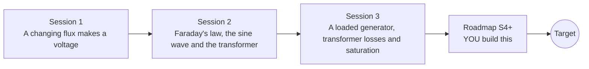

# openinduction

[](https://github.com/KrunalPanchal1995/openinduction/actions/workflows/ci.yml)   [](https://colab.research.google.com/github/KrunalPanchal1995/openinduction/blob/main/sessions/session-01/lesson.ipynb) [](https://krunalpanchal1995.github.io/openinduction/)

**Spin a coil, step a voltage down: how generators and transformers work, in three sessions.**

openinduction teaches Faraday's law of induction from a magnet and a coil to a simulated generator and a transformer with losses, using only Python and a browser.

- **Start from a magnet and a coil.** Session 1 needs only school arithmetic: voltage grows with turns and with how fast the flux changes.
- **See it move.** Every session ships a slider app that runs in the browser, with labelled graphs and a challenge.
- **Know you got it right.** Each session ends with a checkpoint that prints PASS or FAIL against hand calculations, and Session 3 checks energy conservation.
- **Build the missing half.** The repo stops at Session 3 on purpose; the roadmap shows the path to three-phase power, DC and better transformers.

[Target](#the-target) · [Who is this for](#who-is-this-for) · [Quick start](#quick-start) · [Sessions](#sessions) · [Roadmap](#roadmap) · [Contribute](#contribute) · [Explainer PDF](docs/explainer.pdf)

> **This repo is incomplete on purpose.** Sessions 1 to 3 are here and fully working. The finished Target below is a preview of what the community can build next. We show you the path, not the code. Sessions 4 and up are yours.

## The Target

A coil spins between two magnets. Next to it the flux through the coil (blue) and the voltage it makes (red) are drawn, and you can see that the voltage is largest exactly where the flux changes fastest. The coil's voltage then drives a step-up transformer built from two coupled coils, and a second graph shows primary and secondary voltages side by side: the secondary is about 2.4 times larger, and the transformer wastes about 11 percent of the power as heat. Your goal over the coming sessions: build that animation yourself, then extend it to three phases and DC.


*Target: a spinning coil, its flux and EMF, and a step-up transformer (primary and secondary voltages)*


*Target preview: three coils 120 degrees apart give constant total power*


*Target preview: AC turned into smooth DC by a rectifier and a capacitor*

Try it live:

- [Math Visual Studio (open the Studio and explore sine waves and rotation)](https://krunalpanchal1995.github.io/studio/)

How the Target was made is shown only as a path in [promo/roadmap.md](promo/roadmap.md).

## Who is this for
**secondary school to diploma / undergraduate (levels 3-5).** Topic area: Electricity, Magnetism and Electronics.

Prerequisites:

- Voltage, current and resistance (V = I R) and the idea of power (P = V I).
- Sine and cosine of an angle (school trigonometry). Calculus is explained when it appears.
- Python 3.10 or newer; if `python --version` works, you are ready. PRIMER.md explains the rest.
- No prior GitHub experience is needed. Everything is low voltage and simulated: never experiment with mains electricity.

New to Python? Read [PRIMER.md](PRIMER.md) first (10 minutes).

## Quick start

No installation knowledge needed. You need [Git](https://git-scm.com/downloads) and [Python 3.10+](https://www.python.org/downloads/) (Windows: tick "Add Python to PATH"). On Mac and Linux type `python3` wherever this page says `python`.

```bash
git clone https://github.com/KrunalPanchal1995/openinduction.git
cd openinduction
python start.py 1
```

`start.py` creates a private environment, installs what is needed and runs Session 1 with its checkpoint. Next: `python start.py 2`, `python start.py 3`, or `python start.py test` to check everything. Only a checkpoint: `python start.py check 1`.

Four lines turn the idea of Session 2 into a result (they work as they are): Save it as `try.py` and run it with `python start.py run try.py` (this uses the private environment, where NumPy is installed):

```python
import numpy as np
turns, B, area, f = 400, 0.15, 0.002, 10          # a hand-crank generator
peak = turns * B * area * 2 * np.pi * f            # EMF = N B A w, in volts
print(round(peak, 2), "V peak,", round(peak / np.sqrt(2), 2), "V RMS")   # -> 7.54 V peak, 5.33 V RMS
```

Every session also opens in your browser with sliders (no install): [live apps](https://krunalpanchal1995.github.io/openinduction/). Or use the Colab badge above for the notebook.

## Sessions

| # | Session | Model level | Time | Live app |
|---|---|---|---|---|
| 1 | [A changing flux makes a voltage](sessions/session-01/README.md) | Level 1: conceptual interactive model | 60 min | [open](https://krunalpanchal1995.github.io/openinduction/session-01/) |
| 2 | [Faraday's law, the sine wave and the transformer](sessions/session-02/README.md) | Level 2: mathematical engineering model | 75 min | [open](https://krunalpanchal1995.github.io/openinduction/session-02/) |
| 3 | [A loaded generator, transformer losses and saturation](sessions/session-03/README.md) | Level 3: simulation and validation | 90 min | [open](https://krunalpanchal1995.github.io/openinduction/session-03/) |

Each session follows the same six steps: A real-world problem, B concept and theory, C visual explanation, D interactive simulation, E worked example and experiment, F assessment and design challenge. Each ends with `checkpoint.py`, which prints `PASS` or `FAIL` against reference numbers. Session 3 also contains the real-world mini-project: **Design a bicycle dynamo to power a 3 W lamp**.

## Architecture



| Folder or file | What is inside |
|---|---|
| `sessions/` | three sessions: README (A-F), `lesson.py`, notebook, live app, exercises, activity sheet, checkpoint |
| `promo/` | the Target: media, live links, and the roadmap (path only) |
| `docs/` | `explainer.tex` and the built `explainer.pdf` |
| `tests/` | runs every lesson and checkpoint headless |
| `start.py` | one command to set up and run anything |
| `QUALITY.md`, `RUBRIC.md` | the quality checklist and the scoring rubric |
| `.github/` | CI, PDF build, Pages deploy, issue and PR templates |

## Roadmap

| Milestone | What you will build | Difficulty |
|---|---|---|
| Session 4: Three-phase generator | A generator with three coils feeding three equal loads, with a plot of each phase and of the total power. | intermediate |
| Session 5: AC to DC with a rectifier and capacitor | A full-wave rectifier model with two diode drops and a capacitor, simulated in time. | intermediate |
| Session 6: A transformer from two coupled coils | A time-domain model of the primary and secondary currents with winding resistance and a resistive load. | advanced |
| Session 7: Hysteresis and eddy-current losses | A core model with a B-H loop whose area gives the energy lost per cycle, plus an eddy-current loss that depends on lamination thickness. | advanced |
| Session 8: Switch-on inrush current | The saturating core started at a voltage zero crossing with some remanent flux. | advanced |

Full detail with a checkpoint per milestone: [promo/roadmap.md](promo/roadmap.md).

## Contribute
New to GitHub? Read [CONTRIBUTING.md](CONTRIBUTING.md); it starts from zero. Pick an issue labelled `good first issue`. Translations into Hindi, Telugu, Tamil and Malayalam are welcome.

<details>
<summary>Development</summary>

```bash
python start.py test        # runs every lesson and checkpoint
```
Lessons use `# %%` cell markers so they open as notebooks in VS Code. See [QUALITY.md](QUALITY.md) for the standard every session meets.
</details>

## License
MIT. See [LICENSE](LICENSE). Media in `promo/media` is (c) Krunal Panchal, CC BY 4.0.

## Acknowledgments
Part of the [PAN IIT OSS](https://hellofoss.tech-iitb.org/projects) open-source teaching collection, modelled on the structure of [openspline](https://github.com/openspline/openspline). Built on ideas from the Math Visual Studio at https://krunalpanchal1995.github.io/studio/.
