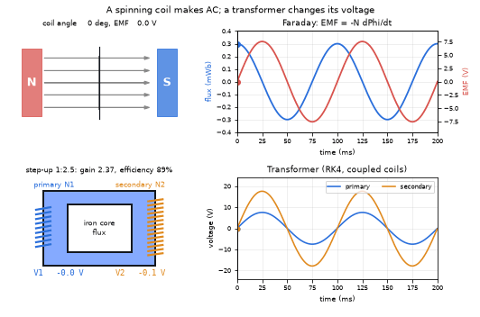
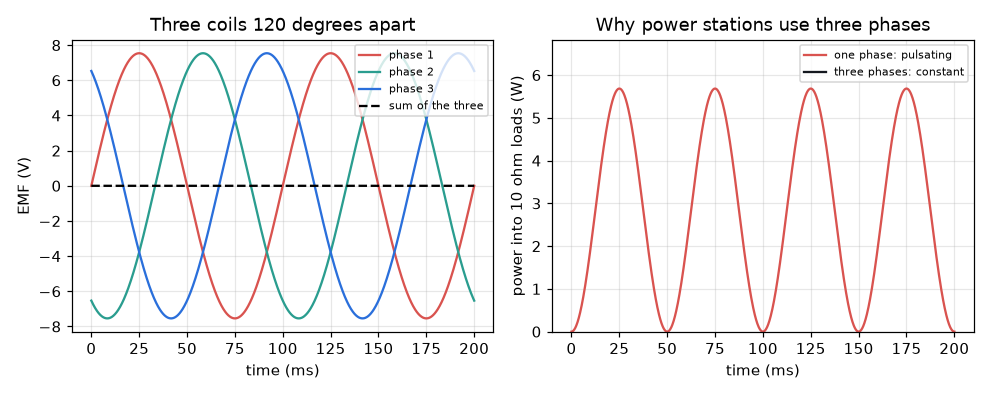
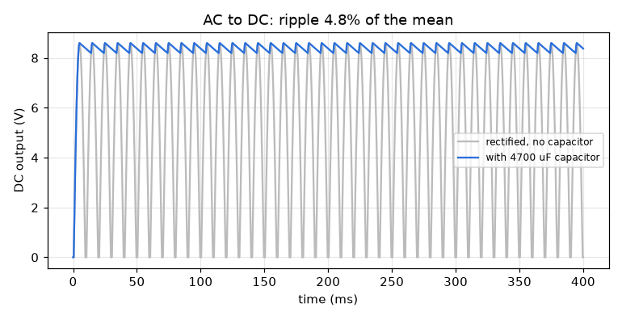

# What you are building toward

A coil spins between two magnets. Next to it the flux through the coil (blue) and the voltage it makes (red) are drawn, and you can see that the voltage is largest exactly where the flux changes fastest. The coil's voltage then drives a step-up transformer built from two coupled coils, and a second graph shows primary and secondary voltages side by side: the secondary is about 2.4 times larger, and the transformer wastes about 11 percent of the power as heat. Your goal over the coming sessions: build that animation yourself, then extend it to three phases and DC.

*Target: a spinning coil, its flux and EMF, and a step-up transformer (primary and secondary voltages)*

*Target preview: three coils 120 degrees apart give constant total power*

*Target preview: AC turned into smooth DC by a rectifier and a capacitor*

These results come from a private reference build. The code is not published; the roadmap shows the path so you can build your own.

Live links:

- [Math Visual Studio (open the Studio and explore sine waves and rotation)](https://krunalpanchal1995.github.io/studio/)
