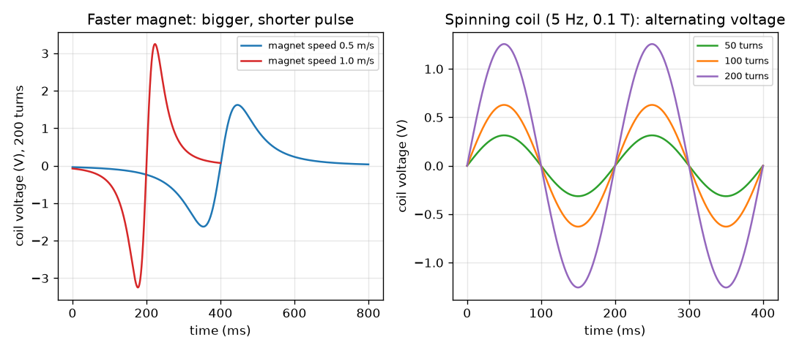

# Session 1: A changing flux makes a voltage

*Level 1 (conceptual interactive model) · about 60 minutes · openinduction*

> This is a simplified educational model. It is not a validated design tool and must not be used for real structures, electrical installations, vehicles, industrial processes or medical decisions.

**Prerequisites**

- Voltage and the idea of a magnet's field.
- You have read PRIMER.md and run `python start.py 1` once.

**Learning objectives.** After this session you can:

- State what electromagnetic induction is: a changing flux through a coil makes a voltage.
- Use emf = turns x (change of flux) / (time taken) for a simple case.
- Explain why a faster magnet or more turns gives more voltage, and why a still magnet gives none.
- Explain why a spinning coil gives an alternating voltage and compute its peak.

## A. Real-world problem
A bicycle dynamo has no battery, yet it lights a lamp when you pedal. Inside there is only a magnet and a coil of wire, and nothing touches. The same trick runs every power station: something turns, and a voltage appears. Where does that voltage come from, and what makes it bigger or smaller? This is a low-voltage educational model: we use small numbers and never work with mains electricity.

## B. Concept and theory
Magnetic flux (symbol Phi) measures how much magnetic field passes through a coil: a stronger field, or a bigger coil facing the field, means more flux. Faraday found that a coil produces a voltage (called an EMF, electromotive force) only while the flux through it is changing. The size of the voltage is the number of turns times the rate of change of the flux. A magnet at rest, however strong, makes no voltage. Push the magnet in and the voltage has one sign; pull it out and the sign reverses: this is Lenz's law, the induced voltage opposes the change that caused it. If the coil spins in a field, the flux rises and falls in every turn, so the voltage swings positive and negative: alternating current (AC). The peak voltage is N B A 2 pi f.

| Symbol | Meaning | Unit |
|---|---|---|
| emf | induced voltage (electromotive force) | V |
| N | number of turns of the coil | no unit |
| Phi | magnetic flux through one turn | Wb (weber) |
| delta Phi / delta t | change of flux divided by the time taken | Wb/s |
| B | magnetic field strength | T (tesla) |
| A | area of the coil | m^2 |
| f | turns per second, the frequency | Hz |

**Assumptions**

- The coil has no resistance and carries no current (we measure the open-circuit voltage).
- The magnet moves along the coil axis at a constant speed, and its flux through the coil is a simple bell-shaped curve (illustrative).
- The field is uniform for the spinning coil.
- Low-voltage educational values only.

$$ \mathcal{E}_{\mathrm{avg}} = N\,\frac{\Delta\Phi}{\Delta t} $$

$$ \Phi = B A\cos\theta $$

$$ \mathcal{E}_{\mathrm{peak}} = N B A\,2\pi f $$

## C. Visual explanation
The left figure shows a 200 turn coil with a magnet pushed through it at two speeds. The voltage is a pulse of one sign while the magnet goes in and a pulse of the opposite sign while it comes out. At 0.5 m/s the peak is 1.62 V and the pass takes 800 ms; at 1.0 m/s the peak is 3.25 V and the pass takes 400 ms: twice as fast gives twice the peak in half the time, but the area of each pulse (volt-seconds) is the same. The right figure shows a spinning coil at 5 Hz in a 0.1 T field: voltage is a sine wave whose height grows in proportion to the number of turns.

*Left: a magnet pushed through a 200 turn coil at two speeds. Right: a spinning coil at 5 Hz makes alternating voltage that grows with the turns.*

## D. Interactive simulation
Run the lesson (`python start.py 1`), then open the live app: [Session 1: a spinning coil in a magnetic field](https://krunalpanchal1995.github.io/openinduction/session-01/) (or `app.html` in this folder). Drag the angle slider to turn the coil and watch the flux and the voltage in the readout; then raise the turns, the field and the speed one at a time and see which one changes the height of the wave and which changes its length.

**Challenge.** Make the peak voltage at least 5 V.

## E. Worked example and experiment
**Problem.** (a) A magnet pushed into a 200 turn coil changes the flux through it by 0.5 mWb in 0.05 s. What is the average voltage, and what if the push takes 0.025 s? (b) What is the peak voltage of a coil with 100 turns, area 0.002 m^2, spun at 5 Hz in a 0.1 T field?

1. (a) Convert 0.5 mWb = 0.0005 Wb. Voltage = N x delta Phi / delta t = 200 x 0.0005 / 0.05 = 2.0 V.
2. Twice as fast: 200 x 0.0005 / 0.025 = 4.0 V. Twice the speed, twice the voltage.
3. (b) Peak = N B A 2 pi f = 100 x 0.1 x 0.002 x 2 x 3.1416 x 5.
4. 100 x 0.1 x 0.002 = 0.02, and 2 pi x 5 = 31.416, so peak = 0.02 x 31.416 = 0.628 V.

**Answer.** (a) 2 V, and 4 V when the push is twice as fast. (b) The peak is 0.628 V.

**Experiment.** Wind about 200 turns of enamelled wire on a cardboard tube, connect it to a sensitive voltmeter (or a multimeter on its smallest millivolt range) and push a bar magnet in and out at slow and fast speeds. You should see a deflection that changes sign and is larger for faster pushes. Real readings will be smaller and noisier than the model: the real flux is not the ideal bell curve, and the coil has resistance and inductance. Never use mains electricity for any of these experiments.

## F. Assessment and design challenge
**Question type A: Conceptual.** Why does a strong magnet resting inside a coil make no voltage? And where does the electrical energy come from when you push the magnet in?

Hint

Ask what must change for a voltage to appear. Then ask who does the pushing.

Step-by-step solution

A voltage needs a changing flux; a magnet at rest gives a constant flux, so the change is zero and the voltage is zero however strong the magnet. When you push the magnet in and a current flows, the induced current makes its own field that resists the motion (Lenz's law), so you must push harder: the electrical energy comes from the work of your hand, not from the magnet.

**Question type B: Numerical.** A coil of 500 turns sees the flux through it grow from 0 to 0.2 mWb in 0.02 s. What is the average voltage? Check that the answer is sensible.

Hint

Convert 0.2 mWb to Wb first, then use emf = N x delta Phi / delta t.

Step-by-step solution

0.2 mWb = 0.0002 Wb. emf = 500 x 0.0002 / 0.02 = 5.0 V. Sense check: 100 times the flux change per second (0.01 Wb/s) times 500 turns gives 5 V. Unit: weber per second is the volt.

**Question type C: Graph and simulation interpretation.** In the left figure the magnet speed is doubled. What happens to (i) the peak voltage, (ii) how long the pulse lasts, (iii) the area of one pulse?

Hint

Compare the red curve with the blue curve.

Step-by-step solution

(i) The peak doubles, from 1.62 V to 3.25 V. (ii) The pulse lasts half as long, 400 ms instead of 800 ms. (iii) The area of one pulse is unchanged (about 0.19 volt-seconds), because it equals N times the total change of flux, which does not depend on speed.

**Question type D: Design and optimisation challenge.** Design: you want a spinning coil with a peak voltage of 3 V. You have N = 100 turns, A = 0.002 m^2 and a 0.1 T magnet. What frequency do you need? If your hand can only turn the coil at 5 Hz, how many turns would you need instead? What is the trade-off?

Hint

Rearrange peak = N B A 2 pi f for f, then for N.

Step-by-step solution

N B A = 100 x 0.1 x 0.002 = 0.02, so f = 3 / (0.02 x 2 pi) = 23.9 Hz. At 5 Hz: N = 3 / (0.1 x 0.002 x 2 pi x 5) = 477.5, so about 478 turns. Trade-off: more turns means more wire, more weight and more resistance, which wastes energy as heat (Session 3); a faster spin needs gearing or more effort. Assumption: ideal coil, no load.

Score yourself with [RUBRIC.md](../../RUBRIC.md). Print the [activity sheet](activity_sheet.md) to work on paper.

## Common misconceptions
| Common misconception | What is actually true |
|---|---|
| A stronger magnet always makes a voltage in a coil. | Only a changing flux makes a voltage. A magnet at rest, however strong, makes none. |
| The magnet gets used up and that is where the electrical energy comes from. | The energy comes from whatever moves the magnet or coil (your hand, the pedals, steam). Lenz's law makes the motion harder when current flows. |
| The voltage is always positive. | Going in and coming out give opposite signs, and a spinning coil gives a voltage that swings positive and negative: AC. |
| Doubling the turns doubles the current in the circuit. | Doubling the turns doubles the voltage. The current also depends on the resistance of the whole circuit. |

## Glossary
- **flux**: the amount of magnetic field passing through a coil; unit weber (Wb)
- **EMF**: electromotive force: the voltage induced in a coil; unit volt
- **induction**: making a voltage with a changing magnetic flux
- **Lenz's law**: the induced voltage acts to oppose the change that causes it
- **AC**: alternating current or voltage: it swings between positive and negative

## Finish
1. Do the three coding tasks in [exercises.md](exercises.md).
2. Run `python start.py 1` again after your changes. It ends with the checkpoint; when it prints `PASS`, you are done. (Checkpoint only: `python start.py check 1`.)

Next: [Session 2](../session-02/README.md)
