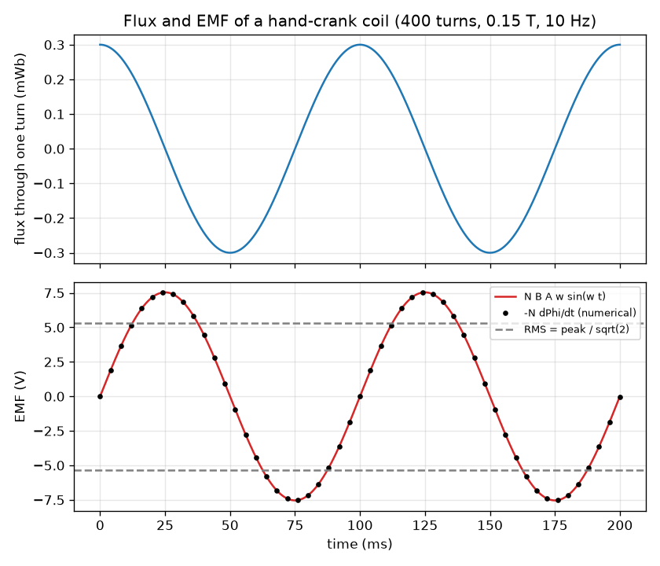
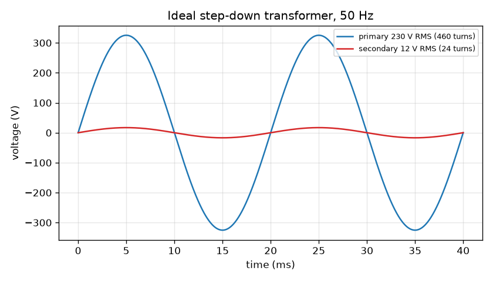

# Session 2: Faraday's law, the sine wave and the transformer

*Level 2 (mathematical engineering model) · about 75 minutes · openinduction*

> This is a simplified educational model. It is not a validated design tool and must not be used for real structures, electrical installations, vehicles, industrial processes or medical decisions.

**Prerequisites**

- Session 1: flux and induced voltage.
- Sine and cosine; the idea of a rate of change (slope of a graph).

**Learning objectives.** After this session you can:

- Write flux = B A cos(theta) and Faraday's law EMF = -N dPhi/dt, and use them to get EMF = N B A w sin(w t).
- Compute the peak and the RMS voltage of a hand-crank generator, and relate frequency, period and the 50 Hz grid.
- Use V2/V1 = N2/N1 and I2/I1 = N1/N2 and explain why power is conserved in an ideal transformer.
- Solve a design problem: the turns ratio and currents of a transformer that steps 230 V down to 12 V for a 24 W load.

## A. Real-world problem
You want a hand-crank torch with no battery: how many turns of wire, how strong a magnet and how fast a crank give a few volts? And your phone charger has to turn the 230 V of the wall socket into a safe low voltage: how many turns does each side need, and how much current flows? Both questions are answered by one law. This is an ideal, low-voltage teaching model: the mains numbers below are for calculation only and you must never experiment with mains electricity.

## B. Concept and theory
Flux through a flat coil of area A in a uniform field B, where theta is the angle between the field and the coil's normal, is Phi = B A cos(theta). Faraday's law says EMF = -N dPhi/dt: the voltage is minus the number of turns times the rate of change of flux (the minus sign is Lenz's law). If the coil turns at constant angular speed w = 2 pi f, then theta = w t, Phi = B A cos(w t) and differentiating gives EMF = N B A w sin(w t), with peak N B A w. Notice the EMF is zero when the flux is largest and largest when the flux is zero (the flux changes fastest as it passes through zero). The RMS value of a sine, the DC value that heats a resistor equally, is peak / sqrt(2). Mains is 50 Hz in many countries: a period of 20 ms and 230 V RMS means a peak of 325 V. An ideal transformer has two coils of N1 and N2 turns on one iron core. The same changing flux threads both coils, so each turn gets the same voltage and V2/V1 = N2/N1. If nothing is wasted, power in equals power out, V1 I1 = V2 I2, so I2/I1 = N1/N2: stepping the voltage down steps the current up. It works only with changing flux: DC makes no flux change and no secondary voltage.

| Symbol | Meaning | Unit |
|---|---|---|
| Phi | flux through one turn | Wb |
| B | magnetic field | T |
| A | coil area | m^2 |
| theta | angle between field and coil normal | rad |
| N | number of turns | no unit |
| w | angular speed, 2 pi f | rad/s |
| f | frequency | Hz |
| EMF | induced voltage | V |
| V1, V2 | primary and secondary RMS voltage | V |
| I1, I2 | primary and secondary RMS current | A |
| N1, N2 | primary and secondary turns | no unit |

**Assumptions**

- Uniform field and a flat coil turning at constant speed.
- The ideal transformer has no resistance, no leakage flux and no core loss.
- Sinusoidal voltages and currents, quoted as RMS unless stated.
- Low-voltage educational model; mains values are only for calculation.

$$ \Phi(t) = B A\cos(\omega t) $$

$$ \mathcal{E} = -N\frac{d\Phi}{dt} = N B A\,\omega\sin(\omega t),\qquad \omega = 2\pi f $$

$$ E_{\mathrm{rms}} = \frac{E_{\mathrm{peak}}}{\sqrt{2}},\qquad T = \frac{1}{f} $$

$$ \frac{V_2}{V_1} = \frac{N_2}{N_1},\qquad \frac{I_2}{I_1} = \frac{N_1}{N_2},\qquad V_1 I_1 = V_2 I_2 $$

## C. Visual explanation
The first figure shows the flux (blue) and the EMF (red) of a hand-crank coil with 400 turns, B = 0.15 T and a 10 Hz spin, over two 100 ms periods. The flux is largest at t = 0 where the EMF is zero, and the EMF peaks at 7.54 V a quarter of a period later, when the flux passes through zero; black dots from the numerical derivative -N dPhi/dt lie exactly on the formula. The grey dashed lines mark the RMS value, 5.33 V. The second figure shows an ideal 460 : 24 turn transformer on 50 Hz: the primary peak is 325.3 V and the secondary peak is 16.97 V, the same shape in the same phase but 19.17 times smaller.

*Flux and EMF of the hand-crank coil: the EMF is a quarter period out of step with the flux and the numerical derivative matches the formula.*

*Ideal 460 : 24 turn step-down transformer on 50 Hz: peaks of 325.3 V and 16.97 V.*

## D. Interactive simulation
Run the lesson (`python start.py 2`), then open the live app: [Session 2: generator and ideal transformer](https://krunalpanchal1995.github.io/openinduction/session-02/) (or `app.html` in this folder). Turn the coil with the phase slider and watch the flux and EMF dots; compare the EMF and flux graphs (they are a quarter period apart); then raise the turns ratio N2/N1 and watch the secondary wave grow in the transformer view.

**Challenge.** Use the transformer to make the secondary RMS voltage between 12 V and 14.5 V.

## E. Worked example and experiment
**Problem.** (a) A hand crank turns a coil of 400 turns, area 0.002 m^2, in a 0.15 T field at 10 Hz. Find the peak and RMS EMF. (b) Design a transformer to supply a 24 W load at 12 V from 230 V: find the turns ratio, the primary turns if the secondary has 24 turns, and both currents.

1. (a) w = 2 pi x 10 = 62.83 rad/s. Peak = N B A w = 400 x 0.15 x 0.002 x 62.83 = 7.54 V.
2. RMS = 7.54 / sqrt(2) = 5.33 V. The period is 1/10 = 100 ms.
3. (b) Turns ratio N1/N2 = 230 / 12 = 19.17. With N2 = 24, N1 = 24 x 19.17 = 460 turns.
4. Secondary current I2 = P / V2 = 24 / 12 = 2.0 A.
5. Primary current I1 = P / V1 = 24 / 230 = 0.104 A. Check: I2 x N2/N1 = 2.0 / 19.17 = 0.104 A, and V1 I1 = 24 W = V2 I2.

**Answer.** (a) peak 7.54 V, RMS 5.33 V. (b) ratio 19.17 : 1, N1 = 460 turns for N2 = 24, I2 = 2.0 A, I1 = 0.104 A.

**Experiment.** Use a low-voltage (battery or signal-generator) arrangement only, never mains: connect a function generator at a few volts, 50 Hz, to a small 12 V transformer wound for it, and measure both sides with a multimeter on AC. You should find the secondary voltage close to the turns ratio but a few percent low under load, and the secondary power a little less than the primary power. The ideal model predicts no loss; the real device loses energy in its wire and iron (Session 3).

## F. Assessment and design challenge
**Question type A: Conceptual.** Why does a transformer work on AC but not on DC? What happens to the current in the primary when you connect a transformer to DC?

Hint

Use Faraday's law: what must the flux do for the secondary to get a voltage?

Step-by-step solution

The secondary voltage is N2 times the rate of change of the core flux. With DC the primary current is constant, the flux is constant and its rate of change is zero, so V2 = 0 after the first instant. Because nothing opposes the primary current (no changing flux), only the small winding resistance limits it, so the primary can draw a large current and overheat. That is why transformers are for AC only.

**Question type B: Numerical.** A coil of 200 turns, area 0.005 m^2, turns at 25 Hz (1500 rpm) in a 0.2 T field. Find the peak and RMS EMF. Check the units.

Hint

Peak = N B A 2 pi f, then divide by sqrt(2).

Step-by-step solution

w = 2 pi x 25 = 157.08 rad/s. Peak = 200 x 0.2 x 0.005 x 157.08 = 31.4 V. RMS = 31.4 / 1.4142 = 22.2 V. Units: T x m^2 = Wb, Wb x rad/s = V (rad is dimensionless).

**Question type C: Graph and simulation interpretation.** In the flux and EMF graph of the hand-crank coil (10 Hz), at which times is the EMF zero and at which times is it largest? What is the flux at those moments?

Hint

Remember the EMF follows the slope of the flux curve.

Step-by-step solution

The EMF is zero at 0, 50 and 100 ms, exactly when the flux is at its maximum or minimum (slope zero). The EMF is largest in size at 25 and 75 ms, when the flux is zero and falling or rising most steeply. So EMF and flux are a quarter of a period (90 degrees) out of step.

**Question type D: Design and optimisation challenge.** Design: a small device needs 5 V at 10 W from 230 V. Choose N2 = 20 turns. Find N1, I2 and I1. Why do small transformers not use very few turns?

Hint

Use the turns ratio V1/V2 and P = V I on both sides.

Step-by-step solution

N1 = 20 x 230 / 5 = 920 turns. I2 = 10 / 5 = 2.0 A. I1 = 10 / 230 = 0.0435 A. The secondary wire must carry 2 A, the primary only 43.5 mA, so it can use thinner wire. The voltage per turn is 230 / 920 = 0.25 V per turn; the core flux needed is proportional to the volts per turn, so with very few turns the core flux would be too large for a small core and it would saturate (Session 3). That is the trade-off between size, number of turns and wire length.

Score yourself with [RUBRIC.md](../../RUBRIC.md). Print the [activity sheet](activity_sheet.md) to work on paper.

## Common misconceptions
| Common misconception | What is actually true |
|---|---|
| The EMF is largest when the flux is largest. | The EMF depends on how fast the flux changes. It is zero when the flux is at a maximum and largest when the flux passes through zero. |
| A step-down transformer also steps the power down. | An ideal transformer keeps the power: voltage goes down by the turns ratio and current goes up by the same factor. |
| The RMS value is the average of the sine wave. | The average of a full sine is zero. RMS is the square root of the mean of the square: the DC value that would heat a resistor equally, peak / sqrt(2) for a sine. |
| A transformer works on a battery. | It needs a changing flux. A battery gives DC, so after the first instant there is no secondary voltage. |

## Glossary
- **Faraday's law**: the induced EMF equals minus the number of turns times the rate of change of flux
- **RMS**: root mean square: the DC value with the same heating effect; peak / sqrt(2) for a sine
- **frequency**: number of cycles per second, in hertz; 50 Hz means a period of 20 ms
- **turns ratio**: N1/N2, the ratio of primary to secondary turns
- **angular speed**: w = 2 pi f in radians per second

## Finish
1. Do the three coding tasks in [exercises.md](exercises.md).
2. Run `python start.py 2` again after your changes. It ends with the checkpoint; when it prints `PASS`, you are done. (Checkpoint only: `python start.py check 2`.)

Next: [Session 3](../session-03/README.md)
