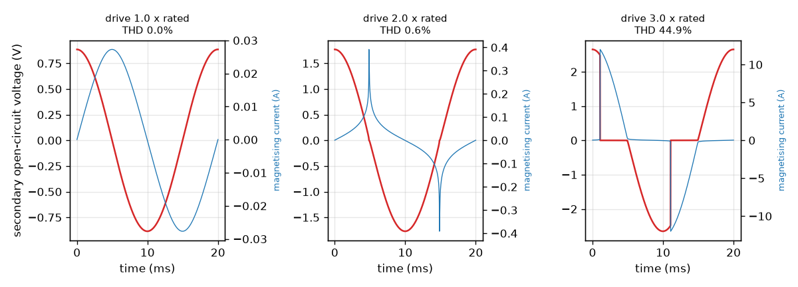
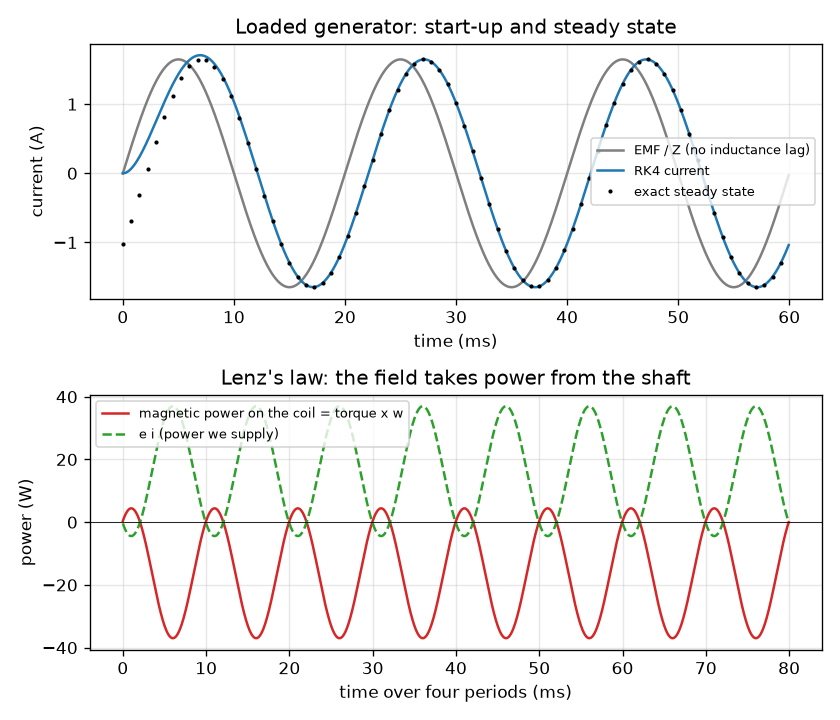
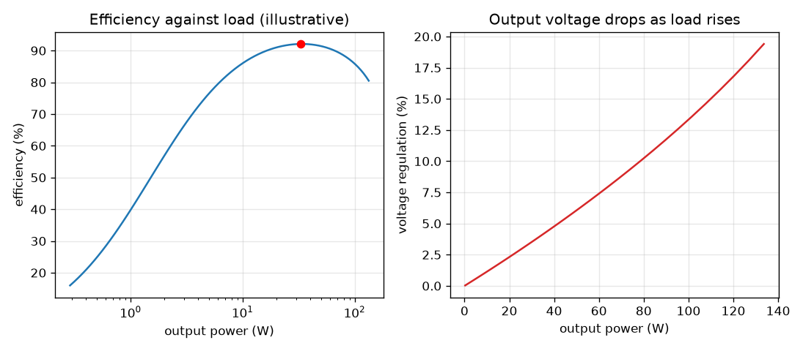

# Session 3: A loaded generator, transformer losses and saturation

*Level 3 (simulation and validation) · about 90 minutes · openinduction*

> This is a simplified educational model. It is not a validated design tool and must not be used for real structures, electrical installations, vehicles, industrial processes or medical decisions.

**Prerequisites**

- Session 2: Faraday's law, RMS and the ideal transformer.
- Resistors, power P = I^2 R, and the idea of inductance (a coil resists changes of current).

**Learning objectives.** After this session you can:

- Simulate a generator with armature resistance and inductance driving a load, using RK4, and validate it against the exact steady state.
- Check energy conservation (mechanical work in = electrical energy out + losses) and see Lenz's law in the sign of the torque.
- Compute transformer efficiency and voltage regulation from a simple copper and core loss model, and find where efficiency peaks.
- Show how core saturation distorts the output, and use the model to size a bicycle dynamo (mini-project).

## A. Real-world problem
A bicycle dynamo lights a 3 W lamp, but its coil has resistance and inductance, so the lamp never sees the full EMF. A transformer is warm after a while because its wire has resistance and its iron wastes energy. And if you push too much flux into the iron, the output is no longer a clean sine wave. Can we simulate these effects, check that no energy is created or lost, and use the model to choose a design? All numbers are illustrative low-voltage teaching values, not measurements of a real machine, and nothing here is a design method for real generators or transformers.

## B. Concept and theory
Generator: the coil EMF e = N B A w sin(w t) drives the armature resistance Ra, the armature inductance L and the load RL in series, so L di/dt = e - (Ra + RL) i. We integrate this with the Runge-Kutta 4th-order method (RK4) and also integrate the energies. The exact steady state is a sine of peak Em / Z where the impedance Z = sqrt((Ra + RL)^2 + (w L)^2); the current lags the EMF by arctan(w L / (Ra + RL)). The magnetic torque on the current-carrying coil is tau = -N B A i sin(w t): its sign is opposite to the rotation when e i is positive. That is Lenz's law, and it means the shaft must supply the mechanical power -tau w = e i. Averaged over whole periods this equals the power in the load plus the heat in the armature resistance. Transformer: the equivalent circuit adds winding resistances (copper loss I^2 Req), a leakage reactance and a core-loss resistance Rc across the primary (core loss V1^2 / Rc, present even with no load). Efficiency is output power over input power, and voltage regulation is the fractional drop of the secondary voltage from no load to load. Efficiency is highest where the copper loss equals the core loss. Saturation: a real iron core can carry only a limited flux. We model the flux linkage as lambda = lambda_s tanh(i / i_s). When the supply pushes more volt-seconds than lambda_s allows, the current spikes and the output is distorted. The equation d lambda/dt = v - rs i is stiff near saturation, so we use implicit backward Euler with a bisection solve. The tanh model is an illustrative teaching model.

| Symbol | Meaning | Unit |
|---|---|---|
| Ra, L, RL | armature resistance, armature inductance, load resistance | ohm, H, ohm |
| Em | peak EMF, N B A w | V |
| Z | impedance of the series circuit | ohm |
| Irms | RMS current | A |
| tau | magnetic torque on the coil | N m |
| Req, Xeq, Rc | equivalent winding resistance, leakage reactance, core-loss resistance (referred to the primary) | ohm |
| eta | efficiency, P_out / P_in | no unit |
| VR | voltage regulation | no unit |
| lambda_s, i_s | saturation flux linkage and knee current of the core model | Wb-turn, A |

**Assumptions**

- A single coil with a constant inductance; no magnetic saturation in the generator.
- Equivalent-circuit transformer with illustrative values (R1 = 30 ohm, R2 = 0.08 ohm, Xeq = 40 ohm, Rc = 35000 ohm on a 460 : 24 turn unit).
- Resistive loads and sinusoidal supply.
- The tanh core model is illustrative and has no hysteresis; nothing here replaces real design data.

$$ L\frac{di}{dt} = E_m\sin(\omega t) - (R_a + R_L)\,i $$

$$ Z = \sqrt{(R_a+R_L)^2 + (\omega L)^2},\qquad I_{\mathrm{rms}} = \frac{E_m}{\sqrt{2}\,Z},\qquad P_{\mathrm{load}} = I_{\mathrm{rms}}^2 R_L $$

$$ \tau = -N B A\, i\sin(\omega t),\qquad P_{\mathrm{mech}} = -\tau\omega = e\,i = P_{\mathrm{load}} + I_{\mathrm{rms}}^2 R_a $$

$$ \eta = \frac{P_{\mathrm{out}}}{P_{\mathrm{out}}+P_{\mathrm{Cu}}+P_{\mathrm{core}}},\qquad \mathrm{VR} = \frac{V_{2,\mathrm{nl}}-V_{2,\mathrm{fl}}}{V_{2,\mathrm{nl}}} $$

$$ \lambda = \lambda_s\tanh\!\left(\frac{i}{i_s}\right),\qquad \frac{d\lambda}{dt} = v - r_s\,i $$

## C. Visual explanation
The first figure shows a generator with N B A = 0.08 V s (250 turns, 0.2 T, 16 cm^2) at 50 Hz with Ra = 2 ohm, L = 30 mH, RL = 10 ohm. The RK4 current starts at zero, settles within about two cycles into the exact steady state (black dots), and lags the EMF by 38.1 degrees. Below it, the magnetic power on the coil (negative on average) is exactly minus the power e i we supply: the field takes energy from the shaft. The second figure shows the transformer: efficiency rises steeply with load, peaks at 92.1 percent near 33 W and then falls as copper loss grows; voltage regulation grows with load. The third figure shows the secondary open-circuit voltage of the saturating core at 1, 2 and 3 times the rated drive: clean at 1 (THD 0.02 percent), starting to show a magnetising current of 1.3 A at 2, and badly distorted at 3 (THD 44.9 percent).

*Saturating core model at 1, 2 and 3 times the rated drive: the secondary voltage distorts once the core saturates.*

*Top: RK4 current against the exact steady state (lag 38.1 degrees). Bottom: the magnetic power on the coil is minus e i: Lenz's law.*

*Transformer with illustrative losses: efficiency peaks at 92.1 percent near 33 W; regulation grows with load.*

## D. Interactive simulation
Run the lesson (`python start.py 3`), then open the live app: [Session 3: loaded generator and transformer](https://krunalpanchal1995.github.io/openinduction/session-03/) (or `app.html` in this folder). Change the armature resistance, load and inductance and watch the RK4 current, then open the power view to see where the load power peaks; switch to the transformer view and move its load to see the efficiency curve.

**Challenge.** Get at least 20 W into the load while the armature wastes at most 15 percent of the mechanical power.

## E. Worked example and experiment
**Problem.** (a) A generator with N B A = 0.08 V s runs at 50 Hz with Ra = 2 ohm, L = 30 mH and RL = 10 ohm. Find the peak EMF, Z, RMS current, load power, armature heat and the mechanical power needed. (b) For the 460 : 24 turn transformer with RL = 6 ohm on its secondary and 230 V on the primary, find V2, efficiency and regulation.

1. (a) w = 2 pi x 50 = 314.16 rad/s. Em = 0.08 x 314.16 = 25.13 V. w L = 314.16 x 0.030 = 9.425 ohm.
2. Z = sqrt((2 + 10)^2 + 9.425^2) = sqrt(144 + 88.83) = 15.26 ohm. Irms = 25.13 / (15.26 x 1.4142) = 1.165 A.
3. Load power = 1.165^2 x 10 = 13.56 W. Armature heat = 1.165^2 x 2 = 2.71 W. Mechanical power = 13.56 + 2.71 = 16.28 W.
4. The RK4 simulation gives the same load power (13.565 W) and a mechanical power of 16.278 W, with an energy balance residual of about 2e-9 J per 0.08 s. The mean torque is -51.8 mN m: 0.0518 N m x 314.16 rad/s = 16.28 W, so the field opposes the rotation.
5. (b) a = 460 / 24 = 19.17, Req = 30 + 19.17^2 x 0.08 = 59.4 ohm, and RL referred to the primary = 19.17^2 x 6 = 2204 ohm. Solving the circuit gives V2 = 11.68 V, output 22.75 W, copper loss 0.61 W and core loss 1.51 W (= 230^2 / 35000).
6. Efficiency = 22.75 / (22.75 + 0.61 + 1.51) = 91.5 percent. Regulation = (12 - 11.68) / 12 = 2.6 percent.

**Answer.** (a) Em = 25.13 V, Z = 15.26 ohm, Irms = 1.165 A, load 13.56 W, armature heat 2.71 W, mechanical input 16.28 W. (b) V2 = 11.68 V, efficiency 91.5 percent, regulation 2.6 percent (illustrative values).

**Experiment.** With a small hand-crank or bicycle dynamo and a 6 V lamp, spin it by hand with the lamp off and then on. You will feel it get harder to turn when the lamp is on: that is the Lenz-law torque. If you can measure the lamp voltage and the crank speed, compare the lamp's brightness at two speeds; it grows more slowly at high speed, as the model with inductance predicts. The model is simpler than the real device: real dynamos have several poles, iron losses and a non-sinusoidal waveform. For the transformer, only use a low-voltage bench transformer with a function generator; never take measurements on mains.

## Real-world application and mini-project: Design a bicycle dynamo to power a 3 W lamp
A bicycle lamp is rated 6 V, 3 W, so its resistance is 6^2 / 3 = 12 ohm. A small roller of radius 0.01 m runs on the tyre, so the coil turns at w = v / 0.01 rad/s when the bike moves at speed v. The coil has B = 0.3 T, area 4e-4 m^2, armature resistance 1.5 ohm and inductance 40 mH. Using `dynamo_power` and `simulate_generator` from Session 3, find the smallest number of turns (in steps of 10) so that the lamp gets at least 3 W at 15 km/h but no more than 4.5 W at 25 km/h, so the bulb survives a fast downhill ride.

**Deliverable:** A script that prints the lamp power at 8, 15 and 25 km/h for turns from 250 to 350 in steps of 10, names the smallest passing number of turns, checks that choice with the RK4 simulation, and saves a plot of lamp power against speed for the chosen coil and for 300 and 330 turns.

**Success looks like:** The smallest passing number of turns is reported (it is 310), giving 3.13 W at 15 km/h and 4.20 W at 25 km/h; 300 turns gives only 2.93 W at 15 km/h, 330 turns gives 4.76 W at 25 km/h, and the RK4 power for 310 turns agrees with the exact value to better than 0.1 percent. Remember that this simplified model ignores that real inductance grows with the square of the turns.

## F. Assessment and design challenge
**Question type A: Conceptual.** A bicycle dynamo is harder to pedal when the lamp is on than when the lamp is off. Explain why using Lenz's law, and say where the energy for the lamp comes from.

Hint

Think about the torque of the magnetic field on the coil when current flows.

Step-by-step solution

With the lamp off there is no current, so no magnetic torque on the coil. With the lamp on a current flows, and the field acts on this current with a torque that opposes the rotation (the sign of the torque is negative, opposite to the motion: Lenz's law). To keep the speed you must supply mechanical power equal to e i, which on average is the lamp power plus the heat in the coil. The energy comes from the rider.

**Question type B: Numerical.** A generator has Em = 20 V peak, Ra = 1 ohm, RL = 9 ohm and negligible inductance. Find the RMS current, the power in the load, the heat in the armature and the mechanical power, and check that they balance.

Hint

With L = 0, Z = Ra + RL. Then P = Irms^2 R for each resistor.

Step-by-step solution

Z = 10 ohm. Irms = 20 / (10 x 1.4142) = 1.414 A. Load power = 1.414^2 x 9 = 18.0 W. Armature heat = 1.414^2 x 1 = 2.0 W. Mechanical power = 20.0 W, which equals Em^2 / (2 Z) = 400 / 20 = 20 W. They balance: 18 + 2 = 20 W.

**Question type C: Graph and simulation interpretation.** In the transformer efficiency figure, the output power is 0.29 W at a load of 500 ohm. Roughly what is the efficiency there (the curve starts near 16 percent), why is it so low, and why does it fall again beyond the peak at about 33 W?

Hint

Compare the fixed core loss with the output power, and ask which loss grows with load.

Step-by-step solution

At 0.29 W the efficiency is about 16 percent because the core loss (1.51 W) is fixed and is much larger than the output power: nearly all the input goes into the core. As the load grows, the output rises while the core loss stays the same, so the efficiency rises. The copper loss grows as the square of the current, so beyond about 33 W (where copper loss equals core loss) it grows faster than the output and the efficiency falls again. At 1 ohm (105.8 W) it has dropped to 85.0 percent and regulation is 14.3 percent.

**Question type D: Design and optimisation challenge.** Design: for the generator in the worked example (Ra = 2 ohm, L = 30 mH, 50 Hz, Em = 25.13 V), which RL gives the largest load power, and what share of the mechanical power does the armature waste there? What RL would you choose if the armature must waste no more than 10 percent, and what load power do you get?

Hint

The load power is largest at RL = sqrt(Ra^2 + (w L)^2). The armature share is Ra / (Ra + RL).

Step-by-step solution

RL = sqrt(2^2 + 9.425^2) = 9.63 ohm gives the maximum load power of 13.57 W, with an armature share of 2 / 11.63 = 17.2 percent. For at most 10 percent, Ra / (Ra + RL) <= 0.1 gives RL >= 18 ohm; at 18 ohm the load power is 11.63 W (and the armature wastes 1.29 W). Trade-off: choosing the best efficiency costs about 14 percent of the load power; a designer balances power and heat.

Score yourself with [RUBRIC.md](../../RUBRIC.md). Print the [activity sheet](activity_sheet.md) to work on paper.

## Common misconceptions
| Common misconception | What is actually true |
|---|---|
| An ideal generator costs no effort to turn once the lamp is connected. | The current makes a torque that opposes the rotation (Lenz's law). The harder the load, the harder it is to turn. |
| The load gets the full EMF of the generator. | Part of the EMF is lost across the armature resistance and inductance; the load sees Irms x RL. |
| Transformers are nearly 100 percent efficient at every load. | Efficiency is low at very light load because the core loss is fixed, and peaks where copper loss equals core loss. |
| A core saturates only when the current is too high. | It saturates when the flux (the volt-seconds of the supply) is too large for the core: too much voltage or too low a frequency. |

## Glossary
- **impedance**: the opposition of a coil-and-resistor circuit to AC current, Z in ohm
- **RK4**: fourth-order Runge-Kutta, a standard accurate method to solve differential equations step by step
- **copper loss**: heat I^2 R in the winding resistance
- **core loss**: power wasted in the iron core, present even with no load
- **voltage regulation**: fractional drop of the output voltage from no load to load
- **saturation**: the iron cannot carry more flux, so the current spikes and the output distorts

## Finish
1. Do the three coding tasks in [exercises.md](exercises.md).
2. Run `python start.py 3` again after your changes. It ends with the checkpoint; when it prints `PASS`, you are done. (Checkpoint only: `python start.py check 3`.)

Next: the [roadmap](../../promo/roadmap.md). Session 4 is yours to build.
